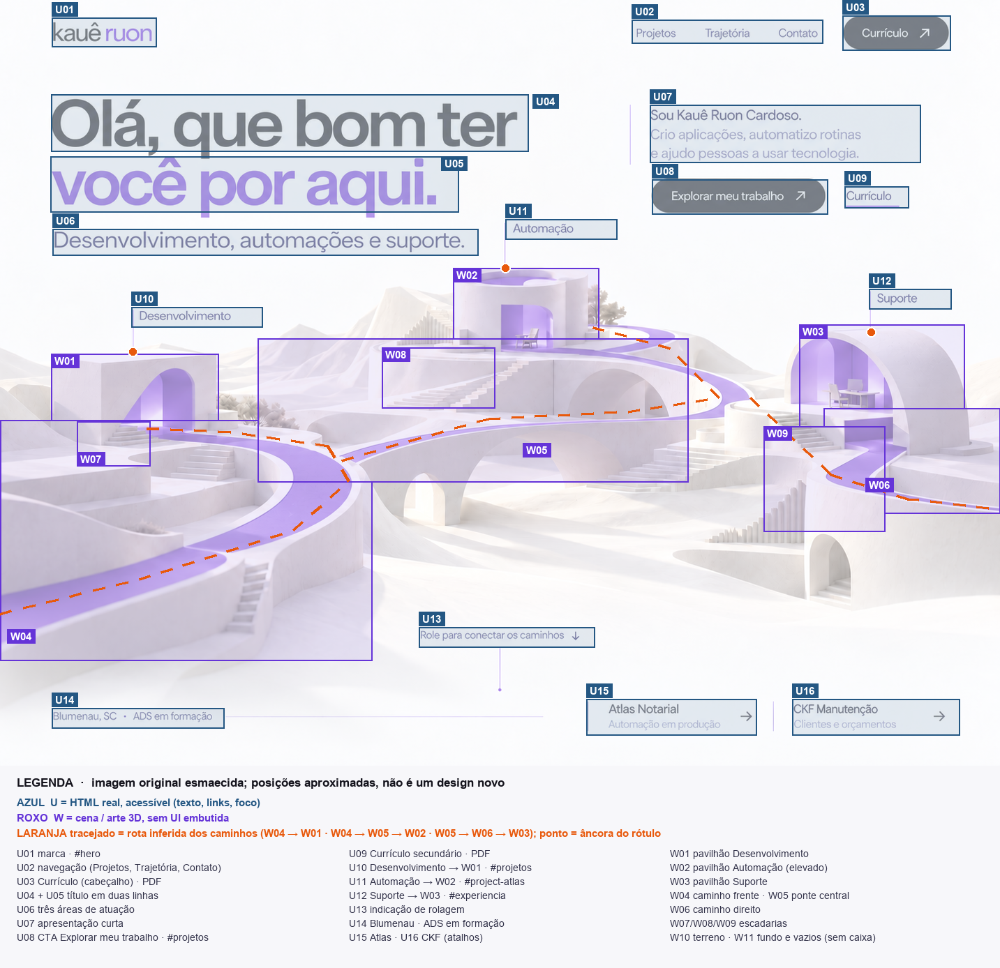
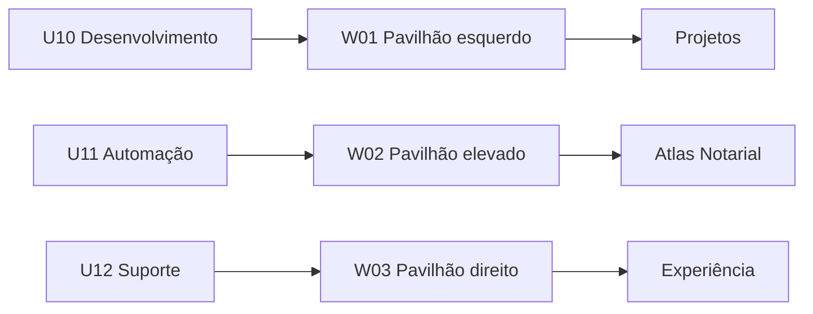
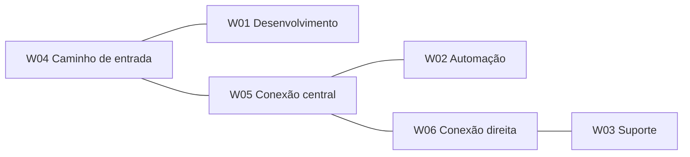
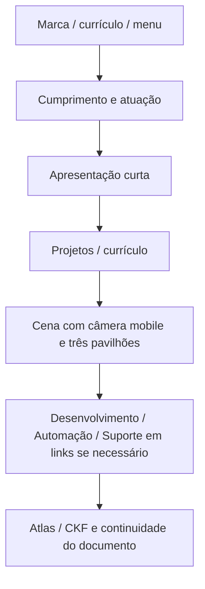

# Mapa espacial da referência aprovada

Este guia acompanha a [imagem original](assets/approved-desktop.png), o [diagrama estrutural](assets/reference-map.svg), sua [versão PNG](assets/reference-map.png) e o [mapa JSON](reference-map.json). Os IDs abaixo são estáveis para comunicação entre agentes, revisão visual e tarefas.

## Como interpretar

- Imagem original verificada: **1433 × 1098 px**. Origem `(0,0)` no canto superior esquerdo; X cresce para a direita e Y para baixo.
- `U` identifica interface HTML real: texto, link, foco e controles. `W` identifica cena/arte: malha, caminhos, terreno e luz.
- Retângulos são **limites semânticos aproximados**, interpretados visualmente. Não são segmentação pixel a pixel, medições CSS nem coordenadas 3D recuperadas.
- No JSON, `bbox_px = [x,y,largura,altura]`; `bbox_normalized` divide X/largura por 1433 e Y/altura por 1098. `anchor_px` é ponto de ligação visual do rótulo ao mundo, não centro de um alvo de toque.
- O diagrama não modifica a referência e não é uma nova proposta estética. As caixas servem para localizar objetos; não devem aparecer no produto.
- Se uma instrução contradizer a imagem, conferir a [especificação canônica](specification.md). A imagem define aparência; a especificação acrescenta comportamento e proteção de acesso. Não inventar movimento ou topologia a partir do PNG.

## Interface: localização e responsabilidade

| ID | Elemento | Limites aproximados X/Y/L/A (px) | Implementação e comportamento |
|---|---|---|---|
| U01 | Marca pessoal, alto à esquerda | 74 / 25 / 150 / 42 | Link HTML para `#hero`; preservar nome acessível |
| U02 | Navegação, alto à direita | 905 / 28 / 274 / 34 | Projetos, Trajetória e Contato; hashes do documento |
| U03 | Currículo do cabeçalho | 1207 / 22 / 155 / 50 | PDF geral atualizado; funciona sem 3D |
| U04 | Primeira linha do cumprimento | 73 / 135 / 684 / 82 | “Olá, que bom ter”, grafite; integra o mesmo H1 de U05 |
| U05 | Segunda linha do cumprimento | 72 / 224 / 585 / 80 | “você por aqui.”, acento `#6534D8`; texto real |
| U06 | Atuação abaixo do cumprimento | 75 / 328 / 610 / 38 | “Desenvolvimento, automações e suporte.” |
| U07 | Apresentação curta à direita | 931 / 150 / 388 / 83 | Texto aprovado da spec; não substituir pela biografia longa |
| U08 | CTA principal | 934 / 257 / 252 / 50 | “Explorar meu trabalho” → `#projetos` |
| U09 | Currículo secundário | 1210 / 267 / 92 / 31 | Mesmo documento geral de U03 |
| U10 | Rótulo Desenvolvimento | 188 / 440 / 188 / 29 | Link → `#projetos`; ligado a W01 |
| U11 | Rótulo Automação | 724 / 314 / 160 / 29 | Link → `#project-atlas`; ligado a W02 |
| U12 | Rótulo Suporte | 1245 / 414 / 118 / 29 | Link → `#experiencia`; ligado a W03 |
| U13 | Indicação de rolagem, base central | 600 / 899 / 252 / 29 | Imagem diz “Role para conectar os caminhos”; spec propõe instrução que também evidencia clique |
| U14 | Localização e formação | 74 / 1015 / 247 / 29 | Blumenau, SC; ADS em formação |
| U15 | Atalho Atlas, base direita | 840 / 1002 / 244 / 52 | Link → `#project-atlas`; estado em produção |
| U16 | Atalho CKF, base direita | 1135 / 1002 / 240 / 52 | Link → `#project-ckf`; clientes/orçamentos |

Os retângulos curtos dos rótulos mostram a área visual observada. A área de interação será ampliada com espaçamento para **pelo menos 44×44 CSS px**, sem confundir pixels da imagem com CSS px. Não criar três H1 nem pintar texto dentro da textura.

## Mundo: objetos, profundidade e preservação

| ID | Objeto | Limites aproximados X/Y/L/A (px) | O que precisa sobreviver à reconstrução |
|---|---|---|---|
| W01 | Pavilhão esquerdo / desenvolvimento | 73 / 507 / 240 / 148 | Volume retangular branco, abertura curva violeta, plataforma e acesso; frente mais próxima da câmera |
| W02 | Pavilhão central / automação | 649 / 384 / 209 / 139 | Volume cilíndrico aberto, mais alto e distante; abertura e interior violeta; ponto focal do fundo |
| W03 | Pavilhão direito / suporte | 1145 / 465 / 237 / 174 | Abóbada branca, interior de trabalho; posição lateral e escala equilibrada com W01 |
| W04 | Caminho de primeiro plano | 0 / 602 / 533 / 345 | Curva entra pelo canto inferior esquerdo e conduz o olhar ao conjunto; espessura e guarda/corpo mineral discretos |
| W05 | Ponte/caminho do centro | 369 / 485 / 617 / 206 | Conexão elevada, arcos e vazios; curva longa organiza o percurso até W02 |
| W06 | Caminho direito | 1180 / 585 / 253 / 151 | Curva sai de W03 para a lateral direita; não cortar sua leitura ao enquadrar |
| W07 | Escadaria esquerda | 110 / 604 / 105 / 64 | Liga patamares de W01; detalhe arquitetônico, sem navegação própria |
| W08 | Escadaria central | 547 / 498 / 162 / 87 | Progressão de altura até W02; profundidade coerente |
| W09 | Escadaria direita | 1094 / 611 / 174 / 151 | Degraus repetidos articulam patamar de W03 e plano inferior |
| W10 | Terreno e plataformas | 0 / 386 / 1433 / 581 | Superfícies claras em camadas, luz suave e sombras de contato; primeiro plano dissolve para o fundo da página |
| W11 | Fundo distante e vazios | 0 / 377 / 1134 / 230 | Distância e respiro por trás das construções; sem adicionar elementos que disputem com U04–U09 |

W10/W11 se sobrepõem aos demais objetos porque descrevem camadas, não caixas exclusivas. Degraus, plantas pequenas e móveis são secundários: podem ter LOD, sem deslocar a silhueta dos pavilhões ou remover a continuidade visual das pontes. Não criar fotos de clientes, interfaces fictícias ou humanos para preencher espaços.

## Ligações entre rótulo, cena e conteúdo

| Destino estável | HTML | Mundo | Ponto de ancoragem aproximado | Ação real |
|---|---|---|---|---|
| `development` | U10 | W01 | (190, 504), cerca de (13,26%, 45,90%) | `#projetos` |
| `automation` | U11 | W02 | (724, 384), cerca de (50,52%, 34,97%) | `#project-atlas` |
| `support` | U12 | W03 | (1248, 476), cerca de (87,09%, 43,35%) | `#experiencia` |

Rótulo, raycast e navegação usam um único cadastro. O controlador gráfico emite somente ID/posição; o wrapper HTML executa a ação do link, incluindo hash, foco e histórico. Se a câmera reposicionar o pavilhão, projetar a âncora novamente. Se o rótulo colidir com texto ou sair da área útil, oferecer o link no fluxo, sem ocultar o destino.

## Caminhos e topologia: o que é inferência

O PNG gerado não comprova continuidade física escondida, largura real, espessura nem encaixes de cada ponte. A reconstrução deve tornar esse sistema coerente, preservando o que é visível:

Esse grafo é uma **proposta de reconstrução**, não uma descoberta de geometria original. Não é necessário permitir caminhar livremente: o movimento limitado de câmera e os destinos clicáveis entregam a interação prevista sem expor superfícies ocultas ainda não modeladas.

## Ordem de camadas e zonas protegidas

1. Fundo da página e W11 distante.
2. W10 e arquitetura estática W01–W09, com profundidade resolvida pelo renderer.
3. Caminhos com material-base violeta; realce discreto no destino ativo.
4. HTML U01–U09: sempre legível e acima da cena. A câmera não transforma o texto.
5. Links projetados U10–U12, com foco e área de toque próprios; camadas visuais não capturam o clique do link.
6. U13–U16 em HTML; a passagem para as próximas seções não depende de pinning.

Zonas sem intrusão de arquitetura: cumprimento/atuação no quadrante superior esquerdo e apresentação/CTAs no superior direito. Sombras e textura pertencem à arte; não aplicar ruído sobre a página inteira. O canvas não substitui header, landmark principal ou leitor de tela.

## Tradução responsiva — contrato, não mock móvel aprovado

Não escalar proporcionalmente os 1433 px da referência para 390 px. A referência é desktop; a composição abaixo é **proposta**:

Em 320–767 px: cena com 260–360 CSS px de altura, alvo de toque 44 px, sem texto sobre aberturas pequenas; navegação completa fora do canvas. Em 768–1023 px: enquadramento intermediário. Em desktop: aproximar relações espaciais do diagrama; em telas largas usar largura máxima para texto e respiro na paisagem. Em inglês, permitir linhas diferentes; a região não pode cortar palavras para imitar o PNG.

## Checklist de trabalho de outro agente

1. Ler AGENTS e a especificação; abrir a referência original e este mapa juntos.
2. Identificar no ticket os IDs afetados; consultar `reference-map.json`, não adivinhar pelo nome do arquivo.
3. Alterar somente a região/responsabilidade da tarefa. Preserve as relações dos demais IDs e os hashes públicos.
4. Validar UI em HTML e cena como recursos separados; jamais usar a imagem completa como poster com textos duplicados.
5. Capturar desktop na proporção da referência e mobile com câmera própria. Comparar cumprimento, respiro, três pavilhões e direção das curvas; documentar diferenças.
6. Testar clique/foco/toque e movimento reduzido se a tarefa tocar na interação. Screenshot estático não prova esses comportamentos.
7. Registrar o que é observado, proposto ou medido. Não transformar limites aproximados deste mapa em números CSS obrigatórios.

O arquivo `build-reference-map.py` reproduz o diagrama e o JSON; não precisa entrar no bundle da aplicação. Para manter documentação consistente, alterar os dados nele e regenerar as saídas, mantendo este guia atualizado. Pillow é dependência do runtime de documentação, não do site.
