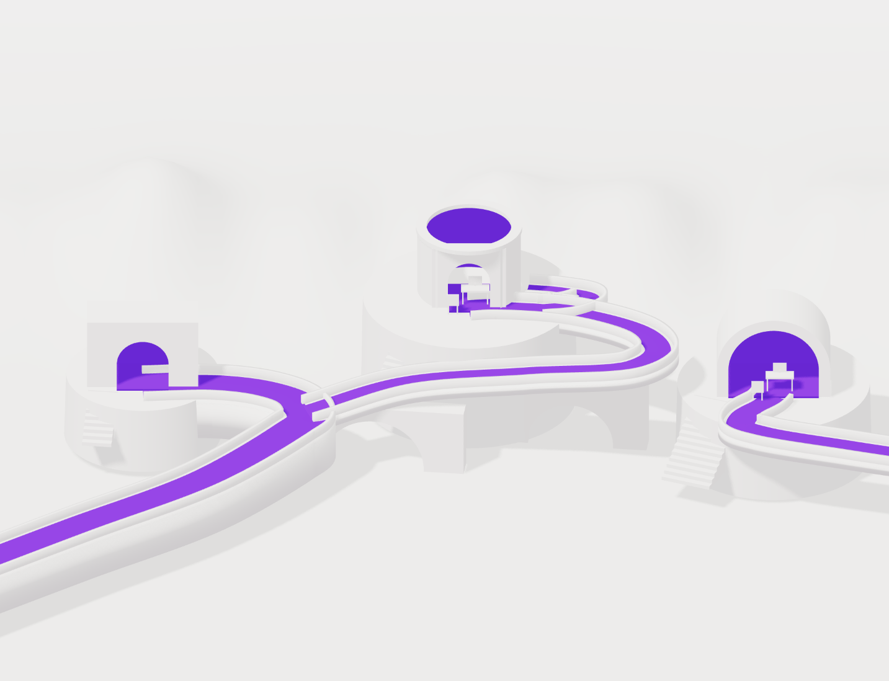
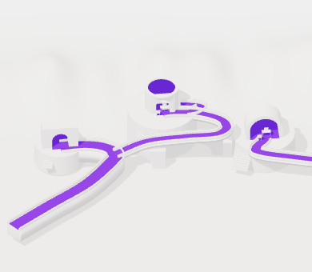

# T01 — prova da paisagem, 28/10/2026

**Estado: experimento implementado; fidelidade final não aprovada. #36 permanece aberta.**
Base `43c8b9b`, branch de trabalho `codex/portfolio-t01-scene`, derivada de
`codex/portfolio-design-integration`. Nenhum componente da aplicação foi substituído.

## Evidência visual

Compare a [referência aprovada](assets/approved-desktop.png) com o
[render desktop 1433×1098](proof/scene-desktop.png) e o
[render mobile 390×340](proof/scene-mobile.png). São capturas de geometria WebGL
real; não são a referência aplicada a um plano nem imagem com tilt.

O trecho prova volume, abertura de pavilhão, espessura da ponte, arco vazado,
degraus e faixa violeta. Os outros dois pavilhões são silhuetas de contexto para
avaliar composição e câmera; não estão finalizados. A câmera desktop usa a
proporção da referência e deixa o espaço superior para HTML. A mobile muda
posição e alvo; não é um recorte do desktop. Os três destinos estão visíveis,
mas seus detalhes pequenos exigem links HTML separados conforme a spec.

**Diferenças materiais que impedem aprovação visual:**

- Relevo muito suave e homogêneo; faltam estratos, recortes e composição das
  montanhas minerais da referência.
- Pedra e luz ainda têm aspecto de maquete. Faltam UVs/material mineral autorado,
  oclusão de contato e luz interna com gradação; os interiores violetas estão planos.
- A estrutura usa patamares cilíndricos simples. Os encontros de pontes,
  guarda-corpos e pavilhões precisam ser autorados como malhas coerentes. Ainda há
  emendas e cruzamentos inadequados, sobretudo na entrada da ponte central e no
  desvio superior. Isso não é uma topologia final navegável.
- A abertura central e o volume direito divergem em proporções/posição. As
  âncoras projetadas são uma proposta, não reprodução exata das caixas do mapa.
- A continuidade escondida atrás de W03 não foi inventada como fato observado.

Houve inspeção inicial desktop/mobile, correção de normais, luz e nivelamento
das rampas com os patamares, seguida de confirmação das capturas. As cunhas
brancas grandes eram interseções da plataforma com uma rampa ainda ascendente,
não falta de antialiasing. O nivelamento corrige essas interseções; não resolve
as emendas da topologia autorada que ainda faltam. Não prolongar ajuste aleatório
de coordenadas como substituto de modelagem.

## Decisão técnica e próxima entrega concreta

**Three.js é viável como renderer; este procedural não é suficiente como asset
final. Recomenda-se modelagem autorada com exportação glTF e oclusão assada.**
Converter o mesmo blockout para GLB não melhora sua aparência.

Ferramentas verificadas: Three 0.185.1 e seu `GLTFExporter`, Vite 7.3.6 já
resolvido pelo Vitest, Chrome local e Playwright do runtime do Codex.
Blender não foi encontrado no PATH nem nas pastas padrão consultadas em
`Program Files`. Nenhuma ferramenta de autoria foi instalada e nenhum asset
externo foi comprado/baixado. A alternativa glTF ainda não tem asset disponível.

Escopo recomendado para a próxima rodada de autoria:

1. Usar `world.ts` como fonte editável de blockout/câmera, preservando o mapa de
   IDs. Modelar primeiro W01 + retorno W04 + arco W05 com encaixes contínuos.
2. Autorizar/disponibilizar uma ferramenta de modelagem local ou fornecer uma
   cena editável. Exportar grupos nomeados e UVs; evitar malhas separadas
   atravessando o caminho. Não trocar por arte rasterizada para mascarar a lacuna.
3. Fazer material mineral e oclusão/luz de contato assada; manter o violeta-base
   `#6534D8`. Comparar o mesmo trecho antes de terminar W02/W03 e o terreno.
4. Exportar GLB com materiais compartilhados e texturas dentro dos limites da
   spec, medir novamente, renderizar posters da mesma câmera e revisar fidelidade.

**Bloqueio para concluir visualmente T02:** posters de produção e geometria
fiel ainda não existem. Os WebP em `proof/` são apenas prova e não devem ser
copiados para `public/images/world/` como assets finais. A revisão guiada deve
apresentar esta diferença; o alvo aprovado permanece o mesmo.

## Medições reais do experimento

Build minificado servido localmente por `vite preview`, Chrome
156.0.8078.48 headless, Windows, ANGLE/D3D11, Intel UHD Graphics 630.
Sem throttling de CPU/rede, sem outro renderer na página da prova. A versão
mobile é viewport emulada na mesma GPU, **não aparelho físico**.
Dados brutos, incluindo âncoras projetadas: [metrics.json](proof/metrics.json).

| Item | Desktop | Mobile emulado |
|---|---:|---:|
| Canvas CSS px | 1433×1098 | 390×340 |
| DPR | 1,5 | 1 |
| Triângulos primeiro frame, incluindo sombra | 72.548 | 72.548 |
| Draw calls primeiro frame, incluindo sombra | 67 | 67 |
| Triângulos em movimento, sombra estática reaproveitada | 47.274 | 47.274 |
| Draw calls em movimento | 34 | 34 |
| Intervalo RAF mediano | 33,3 ms | 16,7 ms |
| Intervalo RAF p95 | 50,0 ms | 16,8 ms |
| Submissão CPU mediana | 2,6 ms | 0,7 ms |
| Submissão CPU p95 | 5,8 ms | 1,6 ms |
| Amostras após 1,5 s de aquecimento | 320 | 588 |

Cada janela tem cerca de 10 segundos de movimento limitado de câmera. O desktop
**não atingiu a meta de 60 fps** nesta configuração. Intervalos RAF incluem
agendamento do navegador; duração CPU de `render` não é tempo GPU. O renderer
mantém `preserveDrawingBuffer` para exportar prova; desligá-lo e testar DPR 1
são próximos testes de otimização, não ganhos já demonstrados. Nenhuma medição
de Web Vitals ou memória GPU completa foi feita.

Bundle da prova: **553,42 KB minificado / 142,95 KB gzip**, incluindo Three e
geometria. Não há textura/cena externa transferida: o ruído de pedra é gerado
localmente. O aviso Vite de chunk >500 KB existe; não indica falha no orçamento
gzip. O bundle é exclusivo da prova, não incremento medido no Next final.
Posters e tamanhos exatos estão em [manifest.json](proof/manifest.json).

## Baseline e validação

- `npm ci`: lockfile preservado. Auditoria npm reportou 18 vulnerabilidades
  existentes (2 moderadas, 13 altas, 3 críticas); sem `audit fix` ou troca de
  versões nesta tarefa. O inventário não é uma análise de explorabilidade.
- `npx tsc --noEmit`: passou antes e depois do experimento. Three 0.185.1 e tipos
  0.173.0 são desalinhados, mas as APIs utilizadas compilaram; não houve upgrade
  especulativo.
- `npm run test`: baseline 5 arquivos / 24 testes passaram; suíte repetida ao
  encerrar. P0 não contém testes de coordenadas artísticas. O experimento não
  adiciona componente de produção; estados/cleanup do futuro renderer ainda
  precisarão dos testes comportamentais definidos em T03.
- `npm run build`: baseline Next 15.5.23 passou; 11 páginas geradas. Rota locale
  15,7 KB, first-load 118 KB, shared 103 KB, conforme saída do build.
- `npx vite build design/scene-proof --outDir ../../.scene-proof-dist`: passou.
- Capturas e medição: sem `pageerror`; scripts locais não enviam formulários nem
  acionam provider ÆVO. API GitHub foi substituída por 503 apenas na captura
  baseline para evitar chamada externa de dados.
- Baseline visual: [desktop](proof/baseline-desktop.png),
  [mobile](proof/baseline-mobile.png). O título antigo ultrapassa a largura
  mobile; limitação anterior, não introduzida pela prova.
- `git diff --check`: verificado antes do commit. `npm run lint` não executado
  separadamente; não afirmar cobertura além do lint/check realizado pelo build.

Inventário de consumidores a migrar em T02/T10: layout monta canvas global,
Three r128/GSAP/ScrollTrigger/Lenis CDN, loader, cursor, animations,
easter-eggs, availability-banner e main.js. `main.js` depende de `loaderDone`
para menu/formulário; globals.css inclui transformações de `heroCanvas`.
Nenhum desses consumidores entra na prova isolada e nenhum foi removido agora.

## Reprodução e procedência

Instruções do servidor: [design/scene-proof/README.md](../../design/scene-proof/README.md).
`capture.cjs` usa Playwright já disponível (`PLAYWRIGHT_MODULE` permite apontar
ao runtime local), gera PNG/WebP e JSON. `--baseline` requer o Next de produção
em `127.0.0.1:4174`. O servidor da prova usa `127.0.0.1:4173`.

Geometria/material procedural foram escritos nesta tarefa; nenhum modelo de
terceiro ou textura licenciada foi importado. A imagem aprovada serve apenas
de referência visual. A API `window.sceneProof` e o loop de medição pertencem
ao harness, não constituem o controlador resiliente de T03.

### Registro de decisões

- Ruling: manter o experimento fora da aplicação e os posters em documentação —
  evita apresentar blockout como produto entregue; custa uma futura integração.
- Ruling: não criar testes unitários de coordenadas — P0 exige prova visual e
  métricas, enquanto os seams funcionais já aprovados serão usados em T02/T03;
  não cobre ciclo de vida do renderer final.
- Ruling: usar silhuetas dos três pavilhões como contexto de câmera — não é
  aprovação nem acabamento dos três; pode exigir remodelagem na autoria final.
