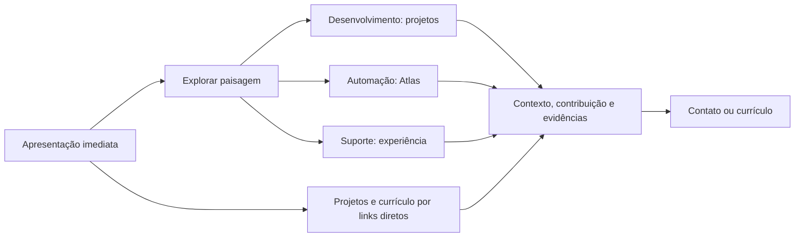

# Especificação — paisagem interativa do portfólio

**Data:** 27/10/2026. **Estado:** base visual aprovada; comportamento proposto para implementação e validação. **Objetivo:** impressionar recrutadores e clientes, tornando fácil entender a atuação de Kauê, verificar projetos e iniciar contato.

## 1. Contrato visual

Referência canônica: `assets/approved-desktop.png`, fornecida e aprovada pelo usuário. SHA-256: `A010410FF773E00A9BE7F40A3AD79DE58F75B311A877728AA7F2C07BC892F0EE`.

Preservar os três pavilhões, as pontes curvas conectadas, a profundidade da paisagem, o branco mineral, a iluminação suave e o espaço limpo para os textos. Não substituir por esferas, um portal isolado, partículas ou construções genéricas. A cena é ilustração conceitual, não evidência de um projeto construído ou de um cliente.

| Elemento | Decisão |
|---|---|
| Fundo | `#F7F7FA`, referência de RUON |
| Texto principal | `#14131C` |
| Texto secundário | `#565565`; confirmar contraste sobre o fundo efetivo |
| Acento claro | **`#6534D8`**, token confirmado em `ruon/src/styles/tokens.css` |
| Superfície / divisória | `#EBEBF0` / `#D9D9E3` |
| Fonte | Instrument Sans para interface e títulos; mono somente onde necessário |
| Formas | Botão principal arredondado; mídia com raio discreto; hierarquia por espaço e tipografia |
| Tema | Claro padrão. Preservar alternativa escura, com `#111015`, texto `#F3F2F5`, acento `#A17AFF`; sua cena ainda exige validação |

A cor em um material 3D muda com luz e gerenciamento de cor. Usar o token como base e comparar o resultado renderizado com a referência; não prometer equivalência de pixels entre textura, material e CSS.

**Copy fixa da abertura pt-BR:**

> Olá, que bom ter  
> você por aqui.
>
> Desenvolvimento, automações e suporte.

**Apresentação à direita:** “Sou Kauê Ruon Cardoso. Crio aplicações, automatizo rotinas e ajudo pessoas a usar tecnologia.”

CTA principal: “Explorar meu trabalho” → `#projetos`. Secundário: “Currículo” → PDF geral atualizado. Cabeçalho: marca pessoal, Projetos, Trajetória e Contato; idiomas e tema em controles secundários discretos. Preservar o nome completo em texto acessível, apresentação e metadados, mesmo com um cumprimento como H1.

Os textos “Desenvolvimento”, “Automação” e “Suporte” permanecem nos três pavilhões. São links, não rótulos puramente decorativos. Acrescentar uma indicação discreta “Explore os caminhos ou role para ver os projetos”, sem exigir que o visitante descubra a interação.

## 2. Jornada e evidências

**Entrada:** busca, GitHub, LinkedIn, currículo, URL direta ou link com hash. Público: recrutadores com pouco tempo e clientes que precisam avaliar capacidade de execução.



Não transformar a leitura do portfólio em um jogo obrigatório. O documento segue navegação vertical, histórico e links normais. Não criar rota pública adicional para uma galeria ou case nesta transição; projetos abrem informações no próprio documento e os links públicos existentes.

### Sequência do documento

1. **Abertura e mundo interativo:** identidade, contribuição e acesso imediato.
2. **Projetos selecionados:** Atlas Notarial e CKF em produção; DocFácil e VECOM em desenvolvimento. Foli como trabalho complementar. Cada um apresenta problema, papel de Kauê, solução, tecnologias, estado e acesso verificável.
3. **Sobre e trajetória:** desenvolvimento, automação e suporte conectados à experiência real; duas experiências profissionais, sem inflar projetos pessoais para empregos.
4. **Competências:** três grupos equilibrados com exemplos de aplicação; nenhuma porcentagem de domínio.
5. **Formação e conquistas:** ADS, OBMEP e cursos confirmados; acesso aos documentos existentes.
6. **Contato:** formulário simples, e-mail, LinkedIn, GitHub e PDFs identificados por objetivo.

Preservar hashes `hero`, `sobre`, `experiencia`, `skills`, `conquistas`, `formacao`, `projetos`, `contato` e IDs `project-atlas`, `project-ckf`, `project-docfacil`, `project-foli`. Acrescentar `project-vecom`. Reordenar visualmente não pode invalidar URLs e ações do assistente.

## 3. Contrato de interação

| Gesto / entrada | Comportamento | Resultado útil |
|---|---|---|
| Mouse sobre a cena | Câmera inclina muito pouco, com amortecimento e limites | Profundidade perceptível sem mover textos |
| Hover / foco em um destino | Caminho correspondente ganha destaque contido; rótulo e destino ficam claros | Antecipar a ação |
| Clique / Enter / toque | Link normal navega ao trecho; a cena pode reagir sem atrasar navegação | Chegar à evidência profissional |
| Rolagem pelo hero | Avanço curto da câmera e progressão sutil do caminho; rolagem nativa | Conectar abertura a projetos |
| Ponteiro sai da cena | Retorno suave ao enquadramento neutro | Evitar câmera deslocada permanentemente |
| Menu / PDF / contato | Ação independente da cena, disponível desde a primeira renderização | Visitante com pressa não espera pelo 3D |

Destinos semânticos: desenvolvimento → `#projetos`; automação → `#project-atlas`; suporte → `#experiencia`, com conteúdo sobre atendimento e diagnóstico em posição encontrável. Raycast e links HTML usam o mesmo cadastro de destinos; não duplicar regras. O canvas é visual e oculto para tecnologia assistiva; os links HTML oferecem nomes e ordem de foco reais.

Não usar órbita livre, voo longo ao clicar, rolagem capturada, cursor falso, áudio automático ou tour obrigatório. Arrastar não é necessário para a versão principal; se uma exploração livre futura for oferecida, será opt-in e terá alternativa por clique e teclado.

### Movimento — parâmetros de projeto, não valores medidos da referência

| Movimento | Proposta inicial | Interrupção / redução |
|---|---|---|
| Hover / foco | 140–180 ms; mudança de contraste e underline | Foco imediato; reduzido sem deslocamento |
| Troca poster → cena | Crossfade 220–300 ms depois do primeiro frame correto | Sem mudar tamanho; poster se falhar |
| Câmera por ponteiro | Desvio máximo inicial 2° por eixo; interpolação com delta de tempo | Retorna ao sair; zero com movimento reduzido |
| Rolagem do hero | Progresso limitado ao hero; deslocamento total inicial até 6% da distância da câmera | Nada de pinning; desativado no reduzido |
| Caminho selecionado | Variação contida de material, 180–250 ms | Sem pulsação infinita; foco não depende da cor |
| Entrada de texto | Texto visível por padrão; eventual entrada até 300 ms e 8 px | Sem esconder conteúdo se script falhar |

Animação deve responder ao estado atual, cancelar intenção anterior e não acumular timelines. Sem loops decorativos permanentes; uma breve revelação inicial e reações ao visitante entregam o momento WOW. A preferência de movimento é observada também quando muda durante a sessão.

## 4. Responsividade e acesso

| Faixa de projeto | Composição e comportamento |
|---|---|
| 320–767 px | Texto empilhado, headline aproximadamente 36–48 px conforme largura; cena com câmera própria e área reservada de 260–360 px; três destinos em links claramente tocáveis abaixo se não couberem na cena |
| 768–1023 px | Introdução em duas colunas se couber; câmera intermediária, rótulos reposicionados por projeção |
| ≥1024 px | Composição próxima à referência; headline fluida até cerca de 88 px; câmera ampla, pavilhões em posições compatíveis com os textos |
| 1440–1920 px | Limitar largura do conteúdo, ampliar a paisagem com espaço lateral; evitar linhas de texto excessivamente longas |

Larguras são faixas de planejamento, não identificação de potência. Escolher qualidade por capacidade e medições, nunca só pelo tamanho da tela. Não recortar um desktop inteiro para simular mobile. Nenhum título, botão ou rótulo essencial pode ficar pintado dentro da imagem de fallback.

Alvos de toque de projeto: 44×44 CSS px; foco visível e ordem lógica; zoom 200%; sem rolagem horizontal a 320 px. Contraste: texto normal ≥4,5:1, títulos grandes ≥3:1, componentes essenciais ≥3:1. Medir o fundo real, inclusive o que aparece atrás dos rótulos.

`prefers-reduced-motion` e modo “Reduzir movimento” desativam deslocamentos de câmera e progressão animada. Canvas não captura gestos verticais: `touch-action: pan-y`. Menu tem botão real, `aria-expanded`, Escape e retorno de foco. Âncoras respeitam cabeçalho fixo e recebem foco útil após ativação explícita. URL com hash entra diretamente no conteúdo sem passeio pela cena.

## 5. Cena: construção e fidelidade

**Recomendação técnica:** Three.js já instalado, dentro de um módulo isolado do hero. Não adicionar React Three Fiber só para esta cena. Usar um único motor via npm; o Three r128 global de CDN não convive com o renderer novo. GSAP não será necessário para o documento inteiro; usar CSS para UI e um loop local para a cena.

### Pipeline visual

1. Separar a referência em requisitos: três pavilhões reconhecíveis, duas pontes dominantes, continuidade de caminhos, terreno em camadas, pedra branca e iluminação. Definir câmera desktop e mobile a partir dessas relações.
2. Construir um trecho demonstrável com terreno, uma ponte curva conectada e um pavilhão real. Geometria procedural permite iniciar sem depender de um arquivo externo. Usar curvas e malhas com espessura; cilindros soltos e caixas não satisfazem o contrato.
3. Comparar silhueta, enquadramento, materiais e cor em screenshot na mesma proporção. Um plano branco com arcos genéricos não equivale ao alvo aprovado.
4. Se o trecho não atingir a referência, produzir um modelo autorado em Blender/glTF, com iluminação estática assada quando útil. O ambiente local ainda não foi verificado para Blender; não pressupor ferramenta instalada nem conversão automática de PNG em modelo.
5. Expandir apenas após a prova de fidelidade e desempenho; organizar grupos nomeados por destino, separar superfícies estáticas e caminhos interativos.

Decisão condicionada: geometria procedural é o primeiro experimento; glTF autorado é a alternativa para atingir fidelidade, não um asset já disponível. Se a troca exigir produção especializada ou reduzir o escopo, apresentar a prova e a diferença ao usuário antes de mudar o compromisso.

### Assets necessários

| ID | Arquivo proposto | Situação / uso |
|---|---|---|
| approved-desktop | `docs/design-transition/assets/approved-desktop.png` | Disponível; referência de composição, não imagem de produção |
| world-poster-desktop | `public/images/world/hero-desktop.webp` | A produzir, sem textos nem UI; estado estático idêntico à câmera inicial |
| world-poster-mobile | `public/images/world/hero-mobile.webp` | A produzir com câmera própria; não cortar cegamente o desktop |
| world-geometry | `src/components/hero-world/scene/buildWorld.ts` ou `public/models/portfolio-world.glb` | Procedural primeiro; arquivo glTF só se escolhido e criado |
| world-materials | `public/images/world/stone-*` | Texturas leves se necessárias; registrar licença/origem |
| resume-general | `public/curriculo_kaue.pdf` | Substituir pelo PDF geral fornecido e verificar download |
| resume-development / support | `public/resumes/kaue-desenvolvimento-automacao.pdf`, `kaue-suporte.pdf` | Cópias dos PDFs fornecidos, identificadas no contato |

O poster de produção deverá sair da cena ou de arte separada consistente. Não usar a captura completa com botões e textos duplicados. Manifesto `public/images/world/manifest.json` registra IDs, fontes, variantes, tamanhos, câmera e prova de uso. Texturas/cena escura são variantes adicionais, ainda não aprovadas visualmente.

## 6. Arquitetura e ciclo de vida

**Estado atual observado:** Next no lockfile 15.5.23, React 19.2.8, Three 0.185.1; tipos de Three 0.173.0. README anuncia versões diferentes. Sem `node_modules` neste checkout; nenhuma suíte ou build foi executada no planejamento.

O layout carrega Three r128, GSAP, ScrollTrigger e Lenis via CDN, além de scripts de loader, cursor, efeitos e formulário. Existe outro `HeroCanvas3D` React no código, mas a página usa canvas global e script legado. O CSS global importa `css/main.css`, que distribui tokens e estilos antigos. Reescrever apenas o hero mantendo esses efeitos ativos causaria colisões.

**Fronteira pública do mundo:** `HeroWorld({ locale, labels, links, motionEnabled })`. Todo texto e link já existe no HTML renderizado no servidor. Somente o renderer é carregado dinamicamente por um wrapper client. Referências do Next “Latest” devem ser adaptadas à versão instalada; não atualizar o framework junto com a reformulação sem motivo verificado.

Durante a migração, modo de preview novo e shell legado são mutuamente exclusivos no layout: o novo nunca monta scripts, loader, cursor ou canvas globais antigos. O modo é interno, temporário e não altera URLs públicas; P6 remove essa seleção transitória. Funções ainda não migradas não são carregadas com o motor antigo: contato disponibiliza e-mail direto até receber o formulário novo. Medir a cena somente nesse ambiente sem runtimes concorrentes.

**Tipos compartilhados propostos:**

```ts
type WorldDestination = 'development' | 'automation' | 'support';
type WorldState = 'poster' | 'loading' | 'ready' | 'paused' | 'fallback';
type WorldQuality = 'standard' | 'economy' | 'static';
type WorldLink = { id: WorldDestination; label: string; href: string };
```

O controlador recebe progresso normalizado do hero, posição normalizada do ponteiro e destino ativo. Nunca atualiza estado React a cada frame. Projeta posições dos rótulos para DOM e evita sobreposição com textos. Estado técnico fica interno, não aparece como telemetria na interface.

**Máquina de estados:** poster → loading → ready. `ready` → paused quando documento/hero não visível; retomar quando útil. Falha de contexto, asset ou inicialização → fallback com poster e links preservados. Redução de movimento ou escolha estática evita inicialização do renderer. Falha não reinicia indefinidamente: oferecer tentativa explícita, se fizer sentido.

Preferência estática → movimento permitido: iniciar carregamento somente quando o hero estiver visível; se estiver fora, continuar poster até reaparecer. Movimento permitido → estático durante loading: invalidar o resultado em andamento e manter poster; resultado tardio é descartado. Hero sai durante loading sem mudança de preferência: não inicializar GPU fora de vista; é aceitável concluir o download, mas aguardar visibilidade para criar renderer. Usar identificador de geração para impedir que respostas antigas remontem a cena.

Um único RAF; resize por `ResizeObserver`; listeners limitados ao hero; cancelar requisições quando possível, descartar resultados tardios, remover observers/listeners e liberar geometria, materiais, texturas, render targets e renderer no unmount. Provar idempotência com Strict Mode e mudança de idioma. O poster só desaparece depois do primeiro frame válido; canvas não recebe foco nem bloqueia links.

## 7. Orçamento e otimização

Valores abaixo são **limites iniciais de engenharia**, não medições ou promessas atuais. Registrar configuração do teste e ajustar apenas com justificativa, preservando qualidade visual.

| Item | Orçamento inicial / critério |
|---|---|
| Core Web Vitals em campo | LCP ≤2,5 s; INP ≤200 ms; CLS ≤0,1 no p75, segmentado por classe de dispositivo |
| Poster transferido | ≤250 KB desktop; ≤150 KB mobile; variantes responsivas e dimensão reservada |
| Runtime 3D adiado | ≤220 KB gzip de JS incremental, medir build real; fora do caminho crítico |
| Cena/texturas externas | ≤2 MB transferidos no modo standard; ≤1 MB economy; sem download 3D no static |
| Geometria / draw calls | Ponto de partida ≤100 mil triângulos e ≤80 chamadas; medir com `renderer.info` |
| DPR | Até 1,5 standard e 1 economy; manter nitidez validada |
| Fluidez | Alvo 60 fps em desktop de referência; ≥30 fps sustentados no mobile de referência durante interação |
| Fora da viewport | Nenhum loop de renderização ativo |

Medir 10 s de exploração após aquecimento. Se mediana de frame time ficar >33 ms por 3 s de interação, reduzir uma vez DPR/qualidade; persistindo, oferecer modo estático e manter navegação. Não oscilar qualidade a cada frame. Controlar movimento por tempo e renderizar sob demanda quando em repouso.

Preferir sombra/oclusão assada e iluminação simples; evitar pós-processamento, sombras grandes dinâmicas, partículas e transparência em camadas. Unificar materiais e instanciar repetições quando necessário. Comprimir glTF/texturas somente quando o ganho superar custo de decoder. Não baixar decoders se a cena procedural não os usa.

Carregar o poster cedo; runtime e geometria após conteúdo inicial e conforme visibilidade/capacidade. `Save-Data`, movimento reduzido e falha WebGL dão experiência estática. Não usar só `hardwareConcurrency` como teste de potência. ÆVO e estatísticas do GitHub não competem com o carregamento principal; assistente discreto, sem abertura automática.

Medições laboratoriais são diagnósticos, não prova de p75 em produção. Campo será verificado após publicação autorizada; se não houver tráfego suficiente, registrar indisponibilidade, não anunciar aprovação.

## 8. Migração de conteúdo e integrações

Currículos fornecidos são a fonte principal: experiência no Tabelionato de Notas e Registro Civil do Distrito de Itoupava desde 08/2023; Iphoneria 11/2021–03/2023; ADS na Cruzeiro do Sul desde 08/2026. Não afirmar equivalência entre nome formal do tabelionato e Cartório Gaya sem confirmação; usar o nome dos PDFs novos.

Atlas: etapa de consulta/preenchimento de aproximadamente 5 minutos para 20 segundos, não o fluxo inteiro. Stack dos currículos: Next.js, TypeScript, APIs REST, Firebase e Vitest. CKF: React, TypeScript, Supabase e Vitest. DocFácil: desenvolvimento, Firebase e piloto LangGraph com revisão humana; não repetir Prisma/streaming sem prova atual. VECOM: MVP em desenvolvimento, React, TypeScript, Playwright e GitHub Actions. Não inventar URL para VECOM ou tornar Atlas público. Foli permanece complementar com repo já registrado.

Atualizar pt-BR/en-US, metadados, JSON-LD, README, `public/llms.txt`, prompts e respostas locais do ÆVO para o mesmo perfil. Remover senioridade e qualificações não sustentadas. Não informar disponibilidade global ou fluência não confirmada.

Preservar `/api/aevo`, `/api/github`, `/api/contato`, contratos de mensagens e proteção de chaves no servidor. Migrar o formulário para React antes de retirar `public/js/main.js`: payload `{nome,email,assunto,mensagem,botcheck,fillTime}`; estados idle/submitting/success/error; bloquear duplicação, preservar texto em erro, traduzir 429/serviço indisponível. Sem JS, oferecer e-mail direto; o endpoint JSON atual não é fallback nativo de um POST de formulário HTML.

Preservar ações úteis do ÆVO, ajustando seus seletores aos novos componentes. `fill_petition_form` pode continuar como alias interno para preencher assunto; linguagem visível passa a “mensagem”. Remover da oferta visual explosões, gravidade e selos; pedidos antigos recebem resposta respeitosa, sem deformar o novo layout. Observar movimento reduzido também nas ações de scroll e highlight do widget.

Tema, idioma, download e clipboard recebem estados reais. Copiar e-mail só mostra sucesso depois da promessa do clipboard; em falha, exibir endereço selecionável. Troca de locale preserva hash e query; scripts novos suportam montagem/desmontagem, permitindo remover o reload obrigatório legado quando validado.

## 9. Estados materiais e critérios de prova

| Estado | Interface esperada | Prova necessária |
|---|---|---|
| HTML inicial / JS desativado | Nome, apresentação, links, PDF e contato legíveis; poster | Captura e navegação sem JS |
| Cena carregando | Poster já visível; sem loader de tela inteira | Rede lenta com botões utilizáveis |
| Cena pronta | Mesma composição, labels alinhados e caminho reativo | Captura + teste funcional no navegador |
| WebGL indisponível / contexto perdido | Poster e links continuam; sem mensagem técnica alarmante | Falha simulada e recuperação |
| Mobile / touch | Sem hover obrigatório; rolagem vertical livre | Toque, orientação e captura |
| Movimento reduzido | Sem câmera deslocando; ações diretas | Preferência em boot e alterada em runtime |
| Teclado | Destinos e menu operáveis com foco visível | Tab/Enter/Escape e retorno de foco |
| Formulário falha / 429 | Campos preservados e opção de e-mail | Respostas mockadas; nenhum envio real de QA |
| GitHub indisponível | Link de perfil útil sem números fictícios | Resposta vazia/erro mockada |
| ÆVO sem provider | Resposta da base local coerente | Testes existentes e novos fatos |
| Idioma / tema / zoom | Sem quebra, hash e contraste preservados | Dois idiomas, dois temas, zoom 200% |

A imagem aprovada confirma somente intenção visual desktop. Fidelidade do 3D, mobile, acessibilidade, estados e desempenho estão **não verificados**. Não atribuir “meets direction” à jornada completa com base nesta imagem.

## 10. Fontes e limites

Consulta em 27/10/2026. Somente fontes primárias; limites numéricos de câmera, bytes e geometria são propostas deste projeto.

- [Next.js: carregamento adiado](https://nextjs.org/docs/app/guides/lazy-loading): separar runtime pesado; `ssr:false` em wrapper client. A documentação consultada é Latest, portanto exige conferir compatibilidade com Next 15.5.23.
- [Three.js: liberação de recursos](https://threejs.org/manual/pages/cleanup.html): dispose explícito de recursos GPU, além do ciclo React.
- [Three.js: GLTFLoader](https://threejs.org/docs/pages/GLTFLoader): opção de importação glTF e extensões, se o asset autorado for adotado.
- [Web Vitals](https://web.dev/articles/vitals): limites LCP/INP/CLS e avaliação no percentil 75.
- [W3C: novidades WCAG 2.2](https://www.w3.org/WAI/standards-guidelines/wcag/new-in-22/): alternativas a arrastar e alvos de interação. O alvo 44 px é escolha do projeto, acima do mínimo AA descrito nessa fonte.
- [W3C: animação por interação](https://www.w3.org/WAI/WCAG22/Understanding/animation-from-interactions.html): controle de movimento, inclusive parallax; o critério 2.3.3 é AAA, adotado como proteção adicional, sem confundi-lo com certificação AA.

**Fora de escopo:** publicar, trocar domínio, reconstruir o site RUON, migrar backend, instalar ferramenta externa, contratar modelagem, onboarding de tracker e criar campanhas. A necessidade de asset 3D especializado continua uma decisão técnica a resolver na prova P0.
