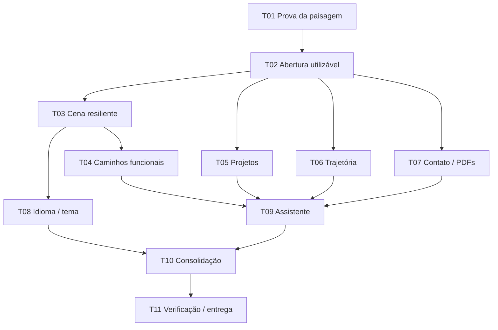

# Tickets publicados — transição de design

**Estado:** divisão aprovada pelo usuário e publicada no GitHub. Verificação em 28/10/2026: 11 issues abertas com `ready-for-agent` e dependências nativas correspondentes ao grafo. T01–T11 são IDs estáveis; os números reais estão abaixo e em `ticket-numbers.json`.

Tracker: `Kauerc10/Portifolio-K.R.001`. Nenhuma issue foi criada novamente ou encerrada nesta reconciliação. Não há issue-pai fornecida.

A proposta refina P0–P7: separa projetos/trajetória, incorpora PDFs ao contato e separa idioma/tema, assistente e consolidação. Cada entrega tem caminho verificável de interface até comportamento e prova, sem tickets horizontais de apenas instalar biblioteca ou editar CSS.

## Divisão aprovada e issues

1. **T01 — Validar uma paisagem fiel em desktop e celular** · [#36](https://github.com/Kauerc10/Portifolio-K.R.001/issues/36)
   - **Bloqueado por:** nenhum.
   - **Entrega:** Demonstrar um trecho da paisagem branca e violeta que preserve a composição aprovada e permita decidir entre geometria procedural e asset autorado antes de expandir a reformulação.
   - [Critérios completos](ticket-drafts/t01-scene-proof.md) · plano: P0.

2. **T02 — Entregar abertura responsiva e navegação antes do 3D** · [#37](https://github.com/Kauerc10/Portifolio-K.R.001/issues/37)
   - **Bloqueado por:** T01.
   - **Entrega:** Permitir que o visitante leia a apresentação, navegue pelo portfólio e abra o currículo imediatamente, com a composição aprovada sobre um poster e sem esperar animações.
   - [Critérios completos](ticket-drafts/t02-usable-shell.md) · plano: P1.

3. **T03 — Carregar a paisagem interativa com pausa e recuperação** · [#38](https://github.com/Kauerc10/Portifolio-K.R.001/issues/38)
   - **Bloqueado por:** T02.
   - **Entrega:** Carregar a paisagem no hero sem bloquear conteúdo e preservar a navegação quando GPU, rede ou carregamento falharem.
   - [Critérios completos](ticket-drafts/t03-resilient-world.md) · plano: P2.

4. **T04 — Explorar os três caminhos por mouse, teclado e toque** · [#39](https://github.com/Kauerc10/Portifolio-K.R.001/issues/39)
   - **Bloqueado por:** T03.
   - **Entrega:** Fazer cada pavilhão conduzir ao conteúdo profissional correto, com respostas visuais contidas que preservam leitura, foco e rolagem.
   - [Critérios completos](ticket-drafts/t04-interactive-paths.md) · plano: P3.

5. **T05 — Apresentar projetos com evidências e estados corretos** · [#40](https://github.com/Kauerc10/Portifolio-K.R.001/issues/40)
   - **Bloqueado por:** T02.
   - **Entrega:** Permitir avaliar os projetos pelo problema, contribuição, solução, tecnologias e evidências reais, em português e inglês.
   - [Critérios completos](ticket-drafts/t05-projects.md) · plano: P4 — projetos.

6. **T06 — Conectar trajetória, competências e formação ao perfil atual** · [#41](https://github.com/Kauerc10/Portifolio-K.R.001/issues/41)
   - **Bloqueado por:** T02.
   - **Entrega:** Mostrar como desenvolvimento, automação e suporte se conectam à experiência de Kauê, com formação e reconhecimentos sustentados pelos currículos.
   - [Critérios completos](ticket-drafts/t06-trajectory.md) · plano: P4 — trajetória.

7. **T07 — Concluir contato e acesso aos currículos com estados reais** · [#42](https://github.com/Kauerc10/Portifolio-K.R.001/issues/42)
   - **Bloqueado por:** T02.
   - **Entrega:** Permitir abrir os currículos atualizados, copiar ou usar o e-mail e enviar uma mensagem com confirmação real, preservando o texto em caso de falha.
   - [Critérios completos](ticket-drafts/t07-contact-resumes.md) · plano: P5 e PDFs do P4.

8. **T08 — Preservar idioma, tema e enquadramento nos modos disponíveis** · [#43](https://github.com/Kauerc10/Portifolio-K.R.001/issues/43)
   - **Bloqueado por:** T03.
   - **Entrega:** Permitir alternar idioma e tema sem perder contexto de navegação, duplicar recursos ou comprometer a identidade visual da paisagem.
   - [Critérios completos](ticket-drafts/t08-locale-theme.md) · plano: P6 — tema e idioma.

9. **T09 — Integrar o ÆVO à nova jornada e aos fatos atualizados** · [#44](https://github.com/Kauerc10/Portifolio-K.R.001/issues/44)
   - **Bloqueado por:** T04, T05, T06, T07.
   - **Entrega:** Manter o assistente útil para encontrar projetos, experiência e currículo e preparar contato, com respostas alinhadas ao perfil atual e sem efeitos que deformem a página.
   - [Critérios completos](ticket-drafts/t09-aevo.md) · plano: P6 — assistente.

10. **T10 — Consolidar a transição e retirar os consumidores legados** · [#45](https://github.com/Kauerc10/Portifolio-K.R.001/issues/45)
   - **Bloqueado por:** T08, T09.
   - **Entrega:** Integrar a experiência completa com um único sistema visual e motor, mantendo rotas e contratos e tornando metadados e documentação coerentes com o perfil.
   - [Critérios completos](ticket-drafts/t10-consolidation.md) · plano: P6 — consolidação.

11. **T11 — Validar a experiência completa e preparar entrega revisável** · [#46](https://github.com/Kauerc10/Portifolio-K.R.001/issues/46)
   - **Bloqueado por:** T10.
   - **Entrega:** Entregar uma prévia comparável ao alvo, com demonstração dos fluxos, medições de desempenho e limitações explícitas, pronta para a revisão guiada antes de publicação separada.
   - [Critérios completos](ticket-drafts/t11-verification.md) · plano: P7.

## Grafo de dependências

## Por que esses bloqueios existem

- T01 fecha fidelidade e poster; T02 pode iniciar exploração de estrutura antes, mas sua conclusão visual depende dessa prova. Não anunciar uma abertura concluída com poster temporário.
- T03 precisa da abertura independente do legado e da geometria já validada. T04 usa seu contrato de picking, projeção e ciclo de vida.
- T05, T06 e T07 só dependem do shell: não esperar o acabamento 3D para organizar conteúdo e contato.
- T08 depende da cena para provar materiais/poster por tema; não depende de conteúdo completo nem dos três caminhos para iniciar.
- T09 testa ações do assistente sobre os destinos, projetos, trajetória e formulário efetivos; por isso depende dessas quatro entregas.
- T10 faz a retirada definitiva e coerência pública quando os consumidores já migraram; T11 verifica a experiência integrada sem transformar publicação em ação automática.

## Critérios de independência

Depois de T02, conteúdo/contato podem avançar enquanto a cena evolui; depois de T03, tema/idioma pode avançar enquanto a navegação é finalizada. Isso define prontidão, não autorização para agentes alterarem os mesmos arquivos ao mesmo tempo. Definir proprietário por arquivo ou integrar sequencialmente quando houver sobreposição de dicionário, layout ou CSS.

## Estado e prontidão

A granularidade e os bloqueios foram aprovados pelo usuário antes da publicação. A label `ready-for-agent` significa que a issue está especificada; não significa que seus bloqueios já foram resolvidos. Na verificação de 28/10/2026 somente T01 / #36 não tem bloqueios abertos. Consultar novamente o GitHub antes de iniciar, pois estado e responsáveis podem mudar.

Os arquivos em `ticket-drafts/` mantêm seus nomes históricos para preservar links, mas são agora cópias de consulta de issues publicadas. Não executar novamente a criação a partir deles. Usar `issue_number` e `issue_url` no registro JSON para retomar trabalho existente.

## Material para o executor

- [Imagem aprovada](assets/approved-desktop.png)
- [Diagrama por ID e instruções](reference-map.md)
- [Mapa de posições e destinos em JSON](reference-map.json)
- [Especificação de interação e comportamento](specification.md)
- [Plano técnico com interfaces, arquivos e testes](../superpowers/plans/2026-10-27-interactive-portfolio.md)
