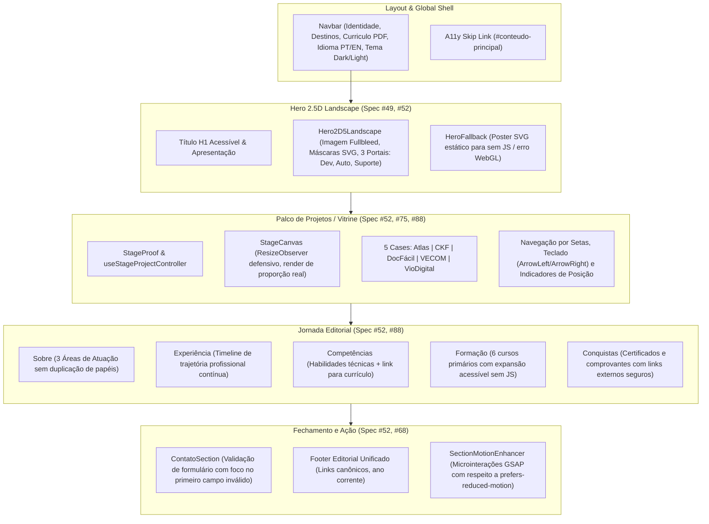

## Summary

Consolidação completa da reformulação do portfólio de Kauê Ruon (#49, #52, #68, #88), integrando o hero 2.5D com máscaras interativas, o palco editorial com 5 cases de projetos (Atlas, CKF, DocFácil, VECOM, VioDigital), seções editoriais contínuas com tipografia hierárquica e microinterações com suporte estrito a acessibilidade e movimento reduzido.

### Arquitetura de Componentes e Fluxo da Página



### Principais Entregáveis

1. **Hero 2.5D dos Portais (#49)**:
   - Imagem dos 3 portais com fita violeta recortada via máscaras SVG vetoriais.
   - Navegação nativa por links HTML acessíveis e marcadores elevados.
   - Zero dependência de WebGL invasivo no runtime do hero; poster fallback e transição fluida.
   - Comportamento responsivo validado de 320px até 1440px+.

2. **Palco de Projetos e Prova de Movimento (#52, #87)**:
   - Vitrine unificada (`StageCanvas` / `StageProof`) exibindo os 5 cases aprovados:
     - **Atlas**: visualização de dados e arquitetura.
     - **CKF**: margens seguras e layout de cartão proporcional.
     - **DocFácil**: selo final contido e hierarquia de documentos.
     - **VECOM**: proporção real de print e moldura sem distorção.
     - **VioDigital**: QR code perfeitamente contido e legível.
   - Suporte completo a navegação por teclado e leitor de tela.

3. **Continuidade Editorial e Seções da Home (#88, #89, #90, #91, #92)**:
   - **H01**: Fundação editorial, metadados localizados, nomes de landmarks sem conflito de idioma.
   - **H02**: Seções Sobre (3 pilares limpos) e Experiência com ritmo de espaçamento editorial.
   - **H03**: Competências, Formação (6 cursos principais com lista expansível estática) e Conquistas.
   - **H04**: Contato integrado com foco de validação imediato e rodapé canônico.
   - Pausa pública do widget ÆVO na home preservando código e utilitários.

4. **Qualidade e Clean Code**:
   - Resolução de `ResizeObserver` não definido em ambientes JSDOM/SSR.
   - Tipagem TypeScript estrita sem suppressions ou `any` desnecessários.
   - Tratamento de movimento reduzido via `@media (prefers-reduced-motion: reduce)`.

---

## Evidence

- **TypeScript Strict Check**:
  ```bash
  $ npx tsc --noEmit
  # Exit code 0 (zero errors)
  ```

- **Vitest Test Suite**:
  ```bash
  $ npm run test
  # Test Files  21 passed (21)
  # Tests       80 passed (80)
  # Duration    25.68s
  ```
  - `home-foundation.test.tsx` (landmarks e i18n)
  - `redesign-journey.test.tsx` (jornada completa spec #52)
  - `hero-interaction.test.tsx` & `hero-landscape.test.tsx` (portais 2.5D e fallback)
  - `projects-motion.test.tsx`, `case-foundation.test.tsx`, `stage-identity.test.ts` (vitrine dos 5 cases)
  - `refinement-micro.test.tsx`, `contact-motion.test.tsx`, `editorial-motion.test.tsx` (microinterações e foco)
  - `formacao.test.tsx`, `components.test.tsx`, `seo.test.ts`, `aevo.test.ts` (demais seções e contratos)

- **Next.js Production Build**:
  ```bash
  $ npm run build
  # Route (app)                              Size     First Load JS
  # ┌ ○ /                                    103 kB   103 kB
  # ├ ○ /404                                 181 B    103 kB
  # ├ ● /cases/[slug]                        1.4 kB   104 kB
  # ├ ● /en-US                               103 kB   103 kB
  # ├ ● /en-US/cases/[slug]                  1.4 kB   104 kB
  # └ ● /pt-BR                               103 kB   103 kB
  # Total: 23 static pages generated cleanly in 19.0s.
  ```

---

## Merge Danger

**Door:** Two-way door.
- O squash merge consolida as alterações em um commit atômico no branch `main`. Em caso de qualquer anomalia não prevista, o rollback pode ser executado instantaneamente via `git revert <squash-commit-sha>`.
- O histórico completo dos 187 commits permanece preservado nos branches de trabalho (`codex/home-editorial-88`, `codex/case-layout-polish`, etc.).

**Blast Radius:**
- **Página Inicial (`/`, `/pt-BR`, `/en-US`)**: Substitui a apresentação anterior pela nova arquitetura editorial e visual 2.5D.
- **Rotas de Cases (`/cases/[slug]`)**: Todas as 5 rotas estáticas permanecem funcionais e integradas aos links profundos do palco.
- **Recursos Estáticos**: Currículo em PDF (`curriculo_kaue.pdf`), favicon e metadados SEO/OG devidamente preservados e linkados.
- **Nenhum breaking change** para APIs externas ou dependências de terceiros.

---

Closes #49
Closes #52
Closes #53
Closes #54
Closes #55
Closes #56
Closes #57
Closes #58
Closes #59
Closes #60
Closes #61
Closes #62
Closes #68
Closes #88
Closes #89
Closes #90
Closes #91
Closes #92
