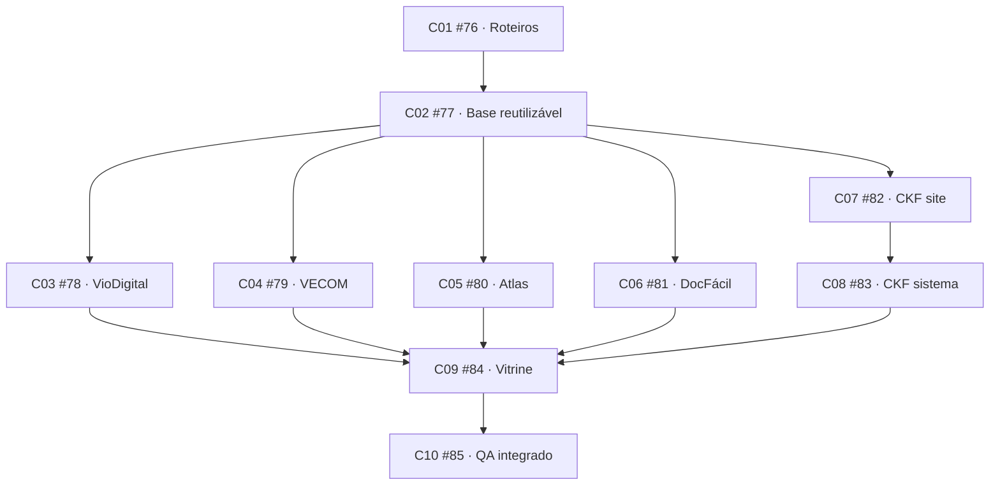

# Execução da spec #75

- Spec: https://github.com/Kauerc10/Portifolio-K.R.001/issues/75
- PR rascunho: https://github.com/Kauerc10/Portifolio-K.R.001/pull/86
- Branch de integração: codex/project-cases-75, baseada em codex/section-motion-68.
- Ritmo acordado: uma entrega por vez, seguida do teste/revisão de Kauê. Dependência técnica não substitui esse aceite.

## Grafo publicado

## Estado

C01 foi implementado documentalmente e integrado em 76170131e29902f318c7692ac4330d9552f9809c. Está pronto para revisão manual de Kauê: [índice e cinco roteiros](roteiros/README.md). Links locais e comparação com os conceitos foram revisados; git diff --check passou. Nenhum código de interface foi alterado por C01 e testes de aplicação não foram repetidos como validação documental.

C01 e C02 aprovados por Kauê; #76 e #77 encerradas. C02 foi integrado em a5cc9e0, com ajuste de foco em 35873e8; [entrega e evidências](c02-handoff.md). C03 #78 foi integrado em 268d601, aprovado por Kauê e encerrado: [entrega e evidências C03](c03-handoff.md). As demais entregas aguardam seu lugar no fluxo e o aceite por ticket.

O trabalho de cada ticket usa branch/worktree próprios, integração na mesma PR e evidência apropriada. Roteiros recebem revisão documental/visual; UI recebe teste no navegador. C04 #79 está atribuído e sem bloqueios abertos. Implementação integrada via d058675, com fechamento visual em 6d89b71, referência v3 e mídia oficial preparada com registros sintéticos. [Entrega e provas C04](c04-handoff.md). C04 e seu refinamento foram aprovados por Kauê; #79 encerrada. C05 #80 Atlas foi atribuído, sem bloqueios abertos, e integrado em a8ddb49, com composição final em 06408a1 e fallback em 16431f2. Está entregue para o teste de Kauê: [entrega C05](c05-handoff.md). [Roteiro Atlas](roteiros/03-atlas.md).

Prévia preservada: http://localhost:3064/pt-BR/projetos/viodigital

## Publicação

Tickets foram publicados com ready-for-agent e bloqueios nativos conferidos. A spec original não foi editada ou encerrada nesta rodada. A PR permanece rascunho; sem merge nem publicação de produção.

C05 #80 foi aprovado por Kauê após os refinamentos de conteúdo e movimento (6978dfc) e encerrado. C06 #81 DocFácil foi integrado em 8461902, com visual em 3f348a1 e validação em c10d3b1. [Entrega C06](c06-handoff.md): prévia, case PT/EN, corujinha original, fluxo ilustrado por scroll e capturas públicas. Testes de navegador locais passaram; aguarda teste e aceite do usuário. C07 permanece fora desta fatia.

C06 #81 DocFácil foi aprovado por Kauê após o preview e encerrado. C07 #82 está atribuído, sem bloqueios abertos, com conteúdo integrado em c388e6b, composição em e764018 e ajustes em b292f96. [Entrega C07](c07-handoff.md): única rota CKF com duas frentes distintas, foco institucional nesta fatia e resumo demonstrativo do sistema. C08 aguarda o aceite desta etapa.

C07 #82 foi aprovado por Kauê após os ajustes de localização, largura e capturas completas (90949f2), e encerrado. C08 #83 está atribuído, sem bloqueios, com narrativa e rota integradas em 5d9b9c2 e demonstração visual em eec3ebd. [Entrega C08](c08-handoff.md): mesmo case CKF, sistema com sequência própria, PDF demonstrativo e galeria separada. C09 permanece aguardando o aceite desta fatia.

C08 #83 foi aprovado por Kauê e encerrado. C09 #84 consolida a vitrine em cinco cases, com leitura rápida, percursos menores, navegação por âncoras e compatibilidade legada. [Entrega C09](c09-handoff.md): testes, build e jornadas locais desktop/celular, PT/EN, tema escuro e fallbacks. C09 aguarda teste do usuário; C10 não iniciado.
