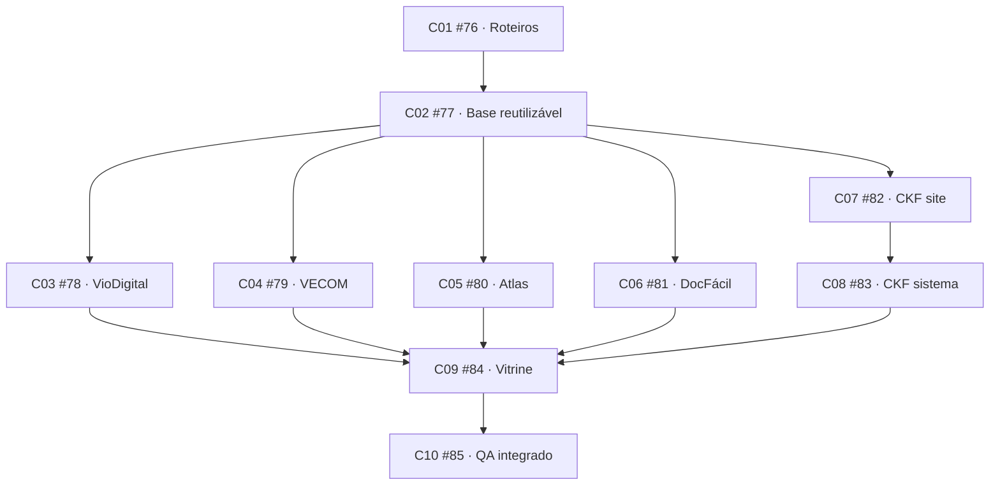

# Execução da spec #75

- Spec: https://github.com/Kauerc10/Portifolio-K.R.001/issues/75
- PR rascunho: https://github.com/Kauerc10/Portifolio-K.R.001/pull/86
- Branch de integração: codex/project-cases-75, baseada em codex/section-motion-68.
- Ritmo acordado: uma entrega por vez, seguida do teste/revisão de Kauê. Dependência técnica não substitui esse aceite.

## Grafo publicado

## Estado

C01 foi implementado documentalmente e integrado em 76170131e29902f318c7692ac4330d9552f9809c. Está pronto para revisão manual de Kauê: [índice e cinco roteiros](roteiros/README.md). Links locais e comparação com os conceitos foram revisados; git diff --check passou. Nenhum código de interface foi alterado por C01 e testes de aplicação não foram repetidos como validação documental.

C01 e C02 aprovados por Kauê; #76 e #77 encerradas. C02 foi integrado em a5cc9e0, com ajuste de foco em 35873e8; [entrega e evidências](c02-handoff.md). C03 #78 foi integrado em 268d601, aprovado por Kauê e encerrado: [entrega e evidências C03](c03-handoff.md). As demais entregas aguardam seu lugar no fluxo e o aceite por ticket.

O trabalho de cada ticket usa branch/worktree próprios, integração na mesma PR e evidência apropriada. Roteiros recebem revisão documental/visual; UI recebe teste no navegador. C04 #79 está atribuído e sem bloqueios abertos. Implementação integrada via d058675, com fechamento visual em 6d89b71, referência v3 e mídia oficial preparada com registros sintéticos. [Entrega e provas C04](c04-handoff.md). C04 permanece aberto até o teste/aceite de Kauê.

Prévia preservada: http://localhost:3064/pt-BR/projetos/viodigital

## Publicação

Tickets foram publicados com ready-for-agent e bloqueios nativos conferidos. A spec original não foi editada ou encerrada nesta rodada. A PR permanece rascunho; sem merge nem publicação de produção.
