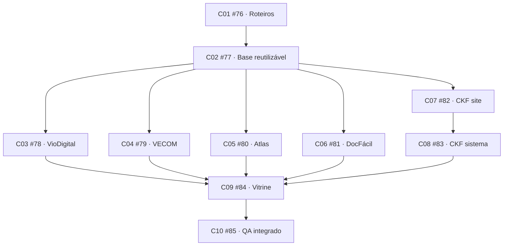

# Execução da spec #75

- Spec: https://github.com/Kauerc10/Portifolio-K.R.001/issues/75
- PR rascunho: https://github.com/Kauerc10/Portifolio-K.R.001/pull/86
- Branch de integração: codex/project-cases-75, baseada em codex/section-motion-68.
- Ritmo acordado: uma entrega por vez, seguida do teste/revisão de Kauê. Dependência técnica não substitui esse aceite.

## Grafo publicado

## Estado

C01 foi implementado documentalmente e integrado em 76170131e29902f318c7692ac4330d9552f9809c. Está pronto para revisão manual de Kauê: [índice e cinco roteiros](roteiros/README.md). Links locais e comparação com os conceitos foram revisados; git diff --check passou. Nenhum código de interface foi alterado por C01 e testes de aplicação não foram repetidos como validação documental.

C01 aprovado por Kauê; #76 encerrada. C02 #77 foi implementado e integrado em a5cc9e0, com ajuste de foco em 35873e8. Está pronto para teste manual de Kauê: [entrega e evidências](c02-handoff.md). A página Vio aprovada foi preservada; isso não conclui automaticamente C03. As demais entregas aguardam as dependências e o aceite por ticket.

O trabalho de cada ticket usa branch/worktree próprios, integração na mesma PR e evidência apropriada. Roteiros recebem revisão documental/visual; UI recebe teste no navegador. C02 permanece aberto até o aceite de Kauê, mantendo C03 e os demais consumidores bloqueados no GitHub.

Prévia preservada: http://localhost:3064/pt-BR/projetos/viodigital

## Publicação

Tickets foram publicados com ready-for-agent e bloqueios nativos conferidos. A spec original não foi editada ou encerrada nesta rodada. A PR permanece rascunho; sem merge nem publicação de produção.
