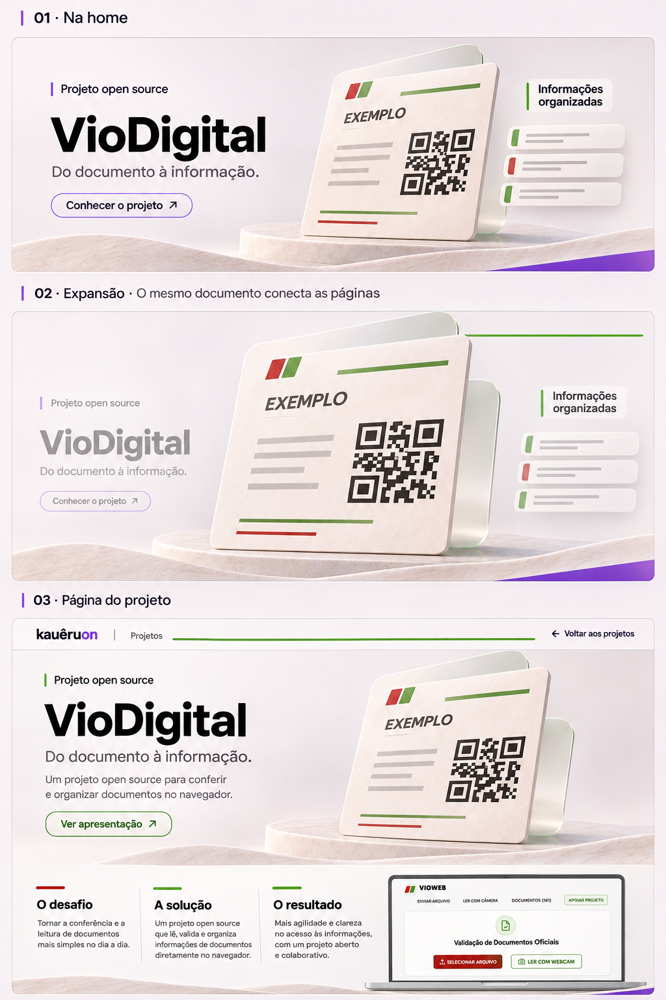
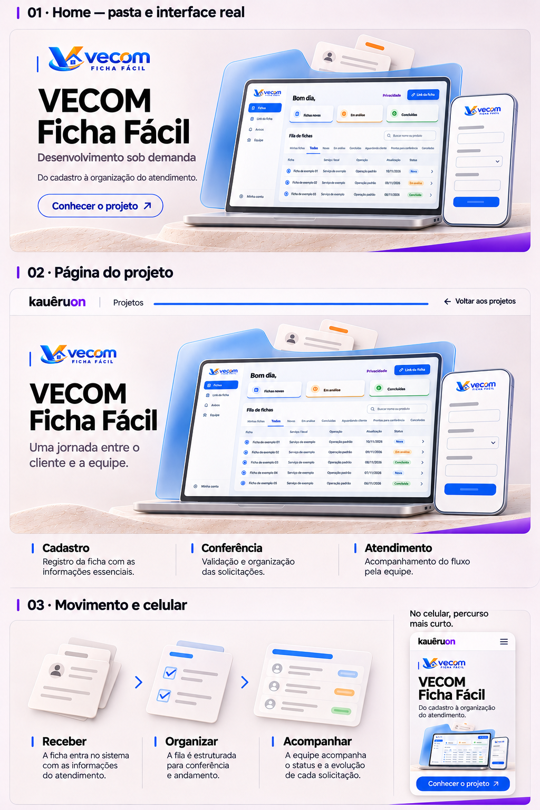
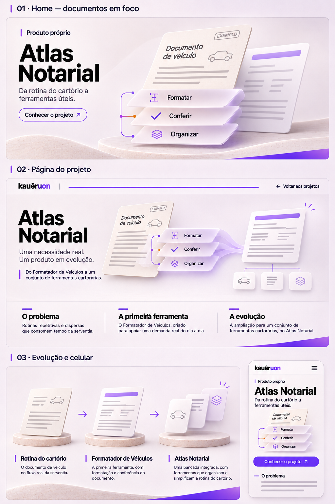
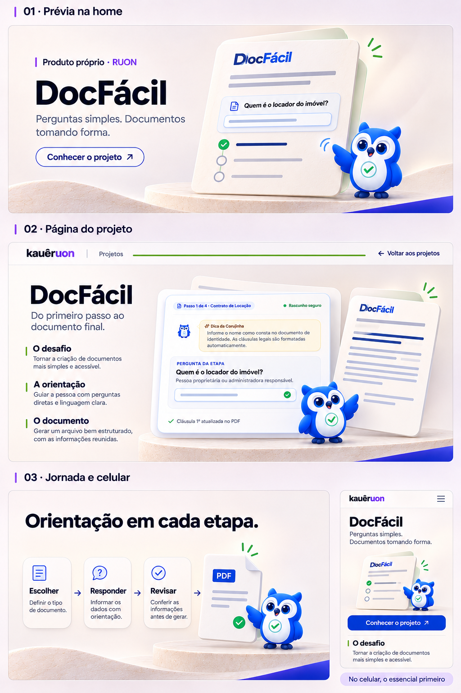
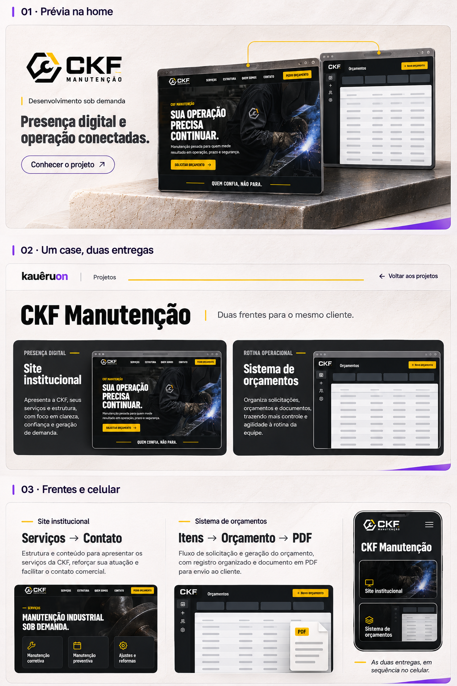

# Roteiros dos cinco cases

Status: C01 — material para revisão manual de Kauê. Este diretório descreve a coreografia e o conteúdo; não contém UI, vídeo final ou decisão entre vídeo, 2.5D e híbrido.

## Índice visual

| Case | Natureza | Referência aprovada | Roteiro |
| --- | --- | --- | --- |
| VioDigital | Open source, iniciativa própria | [storyboard Vio](../../storyboards/viodigital/v1/imagens/02-transicao-case.png) | [01-viodigital.md](01-viodigital.md) |
| VECOM Ficha Fácil | Desenvolvimento sob demanda | [prancha VECOM v3](../v3/imagens/vecom.png) | [02-vecom.md](02-vecom.md) |
| Atlas Notarial | Produto próprio, nascido de necessidade real | [prancha Atlas v3](../v3/imagens/atlas.png) | [03-atlas.md](03-atlas.md) |
| DocFácil | Produto próprio da RUON | [prancha DocFácil v1](../v1/imagens/04-docfacil.png) | [04-docfacil.md](04-docfacil.md) |
| CKF Manutenção | Desenvolvimento sob demanda, duas entregas | [prancha CKF v1](../v1/imagens/05-ckf.png) | [05-ckf.md](05-ckf.md) |

Prévia rápida das referências: [VioDigital](../../storyboards/viodigital/v1/imagens/02-transicao-case.png), [VECOM](../v3/imagens/vecom.png), [Atlas](../v3/imagens/atlas.png), [DocFácil](../v1/imagens/04-docfacil.png) e [CKF](../v1/imagens/05-ckf.png). A tabela mantém os links diretos para abrir cada prancha em tamanho completo.

As referências foram abertas e usadas para a composição. São storyboards/arte conceitual, não prova de funcionamento. O VioDigital já possui duas capturas reais da aplicação pública na página aprovada; as capturas dos outros cases serão preparadas separadamente com dados demonstrativos.

### Pranchas aprovadas para consulta

**VioDigital**

**VECOM Ficha Fácil — v3**

**Atlas Notarial — v3**

**DocFácil**

**CKF Manutenção**

## Coreografia comum

Cada prévia tem três estados explícitos: **chegada** (o elemento é reconhecível e o título já pode ser lido), **transformação** (o scroll conduz uma mudança curta, reversível e observável) e **repouso** (a proposta e o CTA ficam estáveis). O visitante pode clicar no CTA a qualquer momento; a rota do case abre mesmo sem a animação compartilhada. Ao voltar por histórico ou pelo link, a posição e o idioma da home são restaurados sem repetir a introdução.

O pin é temporário, proporcional à composição e termina depois do percurso. Não captura roda/toque, não exige espera por tempo e não esconde título, legenda ou link. Para evitar cinco pins longos consecutivos, a sequência alterna ritmos: Vio usa expansão documental; VECOM usa agrupamento de fichas; Atlas usa evolução; DocFácil usa passos guiados; CKF usa troca entre duas entregas. Entre as transformações há blocos curtos de leitura normal. No celular, cada case reduz etapas secundárias e deixa uma mudança perceptível por gesto; em tela baixa, volta ao fluxo normal quando a composição não couber.

## Contrato de conteúdo e mídia

- Título, natureza do trabalho, resumo, CTA, legendas e controles são HTML acessível, nunca texto embutido no filme.
- PT e EN devem cobrir a mesma informação. A versão EN pode ser mais curta, mas não muda natureza, contribuição ou fatos.
- Ilustração gerada, mockup e storyboard são apresentados como “direção visual” ou “demonstração conceitual”. Screenshot real recebe legenda de origem e data de captura; não publicar dados operacionais.
- Para cada movimento, comparar depois três cenários: (A) vídeo curto controlado pelo scroll; (B) camadas 2.5D/sequence de imagens, com reversão nítida; (C) híbrido, com camadas para texto e mídia ambiente em vídeo. Esta etapa não escolhe uma técnica.
- Movimento reduzido mantém os mesmos textos, CTA e ordem dos capítulos, trocando a transformação por estados estáveis/crossfade discreto. Vídeo fica pausado e poster/resumo textual substitui mídia indisponível.
- Hover/foco, seta, mudança de legenda e abertura de galeria devem confirmar ações sem deslocar o conteúdo. Toda galeria fecha devolvendo o foco.

## Revisão documental antes de C02

Antes de C02, comparar as cinco pranchas e roteiros em sequência: legibilidade prevista em desktop/celular, identidade sem competição e distinção entre próprio/sob demanda. Conferir se cada referência abre, se a legenda identifica direção visual ou captura real e se PT/EN preservam os mesmos fatos. Nenhum roteiro autoriza publicar ou inventar métrica, estágio, contrato, autoria exclusiva ou integração entre produtos.

Os cenários de navegador — link direto, nova aba, refresh, teclado, tema claro/escuro, PT/EN, tela baixa, reduced motion, falha de mídia e retorno ao scroll — ficam para a implementação e validação de cada case. Não há UI implementada neste C01.
